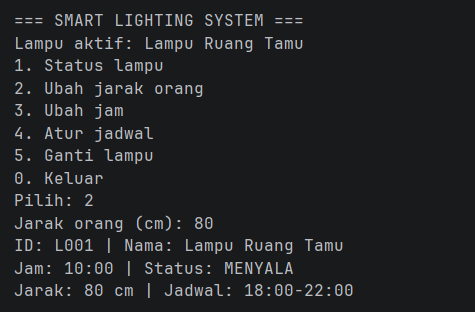
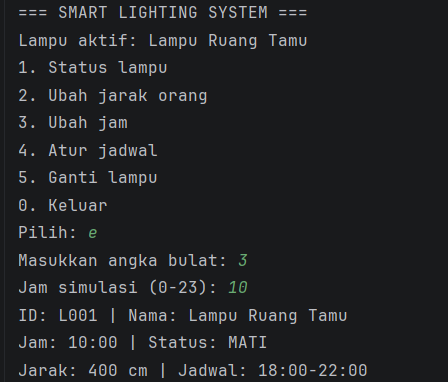

# Lampu Pintar

## Identitas

- **Nama:** Fakhri Zaki Husnayan
- **NIM:** H1D025075
- **Digit terakhir NIM:** 5
- **Tema responsi:** IoT
- **Judul proyek:** Smart Lighting System

## Cara Menjalankan Program

Program ini dibuat melalui java dan dijalankan melalui terminal. Pastikan JDK sudah terpasang di komputer.te
Buka folder proyek `ResponsiPBO`, lalu buka terminal di folder tersebut. Jalankan perintah berikut secara berurutan:

```bash
cd src
javac Main.java
java Main
```

## Alternatif
Langsung tekan run di tombol warna hijau di atas kanan pada file Main

Setelah program berjalan, pilih menu dengan mengetik angka yang tersedia tapi harus bilangan bulat. Kamu bisa mencoba menu **2** dan memasukkan jarak **80 cm** untuk melihat Lampu Ruang Tamu menyala otomatis. Menu **5** digunakan untuk berpindah ke Lampu Teras.

## Screenshot Hasil Program

Berikut tampilan terminal setelah jarak orang diatur menjadi 80 cm sehingga Lampu Ruang Tamu menyala.



Screenshot output lain untuk mengubah jadwal jam yang ditentukan. Jam nya disesuaikan dengan yang diinginkan, hanya bisa 0-23-


